# LoxiLB UC-8 공유 추론 서비스 UI 사용자 매뉴얼

Support와 Research가 하나의 추론 서비스를 공유할 때 관리자가 팀별 키, 모델 접근 범위, 요청 예산, 우선순위 및 대기열을 설정하고 실제 요청으로 확인하는 실습입니다. UI 필드 이름은 영어 그대로 표기합니다. 설명용 값은 각자 준비한 전용 환경에 맞게 바꾸세요.

**검증 기록 · 2026-10-28 KST. 최신 Gateway 기본 UI 실습과 정리 리허설 완료.** 전용 원격 Linux 테스트베드에서 최종 `start.sh`를 새 프로젝트로 시작하고, 별도 실습 프로젝트에서 두 합성 모델 경로·키·quota·대기열·저장소 장애와 복구를 실제 UI와 합성 backend로 확인했습니다. 수정된 실습 Compose에서 동일 Gateway 컨테이너 재시작 전후 objective와 요청 전달을 확인했습니다. 공개 소스에서 Gateway·OAM·UI를 새로 빌드한 조합의 시작과 두 모델의 재시작 전후 요청도 확인했습니다. 세부 이미지와 검증 범위는 패키지 안내에 기록했습니다. 화면에는 실습 당시 실제 주소가 보일 수 있으므로 실행 시 `status.sh`의 주소를 사용하세요. 기본 실습의 시험 범위는 [검증 범위](VALIDATION.ko.html)를 확인하세요. 기존 단계별 스크린샷은 이전 버전의 실제 화면입니다.

## 1. 접속과 실습 대상 확인

### 1.1 로컬 all-in-one 테스트베드 시작

먼저 [all-in-one 실습 패키지](lab/README.ko.html)를 **전용 Linux 호스트**에서 설치합니다. 이 패키지는 UI, OAM, Gateway, PostgreSQL, 합성 backend 두 개와 client를 하나의 Compose 프로젝트로 준비합니다. Mac에서는 Docker를 실행하지 않습니다. 별도 네트워크이지만 Gateway는 privileged이며 호스트 커널을 공유합니다. 최종 시작 스크립트는 별도 신규 프로젝트에서 검증했습니다.

패키지의 `start.sh`가 성공한 뒤 같은 디렉터리에서 다음을 실행합니다.

```bash
bash status.sh
```

출력된 Gateway IP, Backend IP, UI 포트를 아래 표와 rule 입력에 사용합니다. `status.sh` 실패는 준비 미완료입니다. 원격 호스트라면 [패키지 안내](lab/README.ko.html)의 SSH 터널로 UI를 엽니다. UI 최초 Setup의 새 관리자 계정과 비밀번호는 사용자가 직접 입력합니다.

### 1.2 패키지에 Gateway 등록

1. UI에서 로그인 후 **Instances → Add New Instance**를 선택합니다.
2. 이름은 `uc8-manual`, Host는 status가 보여준 Gateway IP, Port는 `11111`, Protocol은 `http`, Version은 `v1`을 입력합니다. 필드가 다른 경우 해당 UI 도움말을 확인합니다.
3. **Container Image**와 **Tag**에도 사용한 Gateway 이미지 이름과 tag를 입력하고 **Create → OK**를 누릅니다. 이 필드의 표시는 실행 바이너리 증명이 아니므로 이미지 digest를 별도로 기록합니다.
4. 목록에서 Healthy / Active를 확인하고 해당 인스턴스를 선택합니다. 2026-10-28 전용 원격 실습에서 이 등록과 Healthy / Active를 확인했습니다.

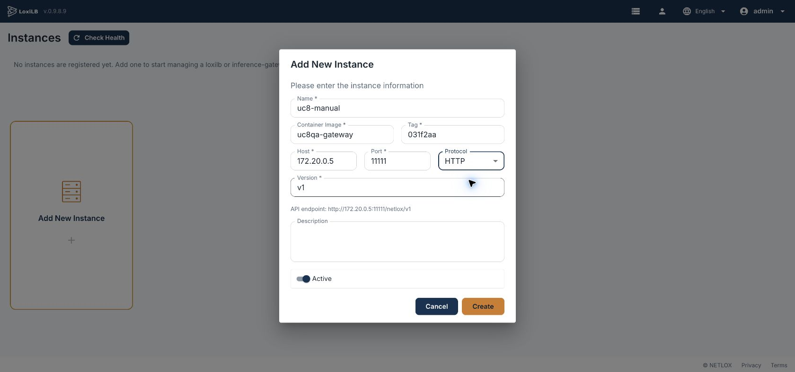

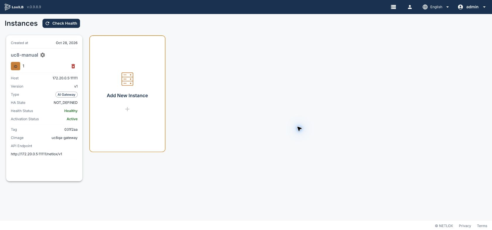

관리 UI는 OAM을 통해 Gateway를 관리합니다. 추론 client는 별도 데이터 경로로 Gateway VIP에 요청하며 Gateway는 backend로 전달합니다. 저장소는 테넌트, 키, objective 등의 정책을 보관합니다. 관리 UI 로그인과 추론 API key는 서로 다릅니다.

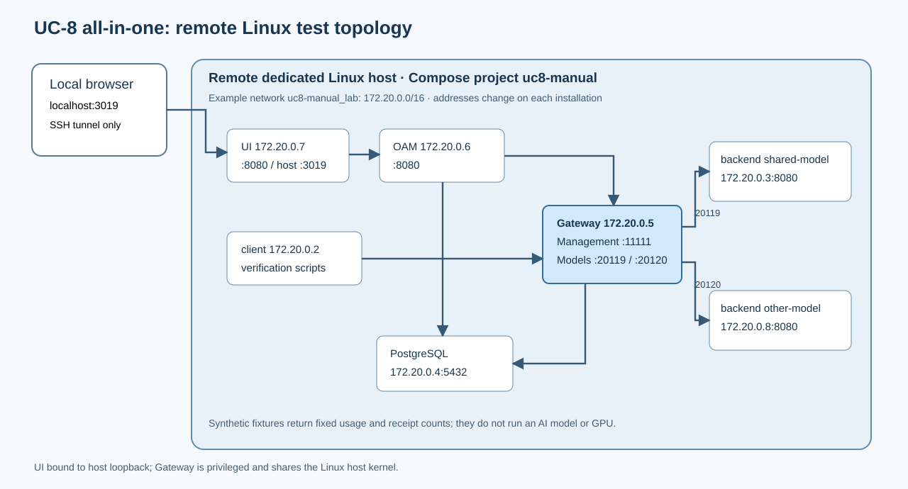

위 주소는 2026-10-28 원격 실습의 **실측 예시**이며 고정 주소가 아닙니다. 모든 컨테이너는 Compose 격리 네트워크 `uc8-manual_lab`에 있습니다. 실행할 때마다 `bash status.sh`로 Gateway와 두 endpoint 주소를 읽고 UI 입력값을 바꾸세요. 그림의 `20119`와 `20120`은 UI에서 rule을 만든 이후의 listener이고 host에 publish하지 않습니다.

| 경로 / 구성요소 | 실측 주소 및 포트 | 용도 |
|---|---|---|
| Mac 브라우저 → SSH 터널 → 원격 host loopback | `localhost:3019` → `127.0.0.1:3019` | UI 접속. Docker는 원격 Linux에서만 실행 |
| UI / OAM | `172.20.0.7:8080` / `172.20.0.6:8080` | 브라우저 화면 / 관리 API |
| Gateway | `172.20.0.5:11111`, `:20119`, `:20120` | 관리 API / shared-model / other-model |
| PostgreSQL | `172.20.0.4:5432` | 정책과 관리 데이터 |
| client | `172.20.0.2` | 데이터 요청과 receipt 확인 |
| 두 합성 backend | `172.20.0.3:8080`, `172.20.0.8:8080` | 모델별 별도 수신 기록. 실제 모델 엔진이 아님 |

UI 호스트 포트는 loopback에만 노출되고 내부 IP는 Docker 네트워크 전용입니다. `UC8_PROJECT`와 `UC8_UI_PORT`를 바꾸면 별도의 프로젝트를 만들 수 있습니다. Gateway는 privileged 컨테이너이므로 호스트 커널을 공유합니다.

| 역할 | 이 문서의 예시 | 선택 기준 |
|---|---|---|
| UI·OAM | 관리자가 제공한 전용 UI 주소 | 관리자가 확인한 격리된 실습 인스턴스 |
| Gateway | 고유 인스턴스, VIP 및 포트 | 해당 client에서 접근 가능한 전용 listener |
| Backend | `shared-model`, port 8080 | 실제 모델명과 endpoint를 준비. receipt/hold는 별도 합성 fixture |
| 팀 A / 팀 B | `uc8-support` / `uc8-research` | 다른 실습 및 운영 tenant와 겹치지 않는 ID |
| 추론 모델 | `shared-model`, `other-model` | 엔진이 제공하는 정확한 모델 식별자. 두 번째 모델은 별도 endpoint/rule 준비 필요 |
| objective | `uc8-interactive` / `uc8-batch` | 다른 사용자에게 영향 없는 고유 이름 |
| Rule / Key | `uc8-shared` / `uc8-support-key`, `uc8-research-key` | 이름으로 정확한 실습 자원을 구분 |

1. 준비된 UI에 관리 계정으로 로그인합니다. 인스턴스 목록에서 **실습용 Gateway**를 선택하고 상단 breadcrumb와 메뉴의 인스턴스 이름을 다시 확인합니다.
2. 관리자가 제공한 방식으로 Gateway의 `/status/ready`와 objective, API key 조회가 정상인지 확인합니다. `/version`의 200만으로 준비 완료를 판단하지 않습니다. 목록이 읽기 실패이면 빈 목록으로 취급하지 말고 중단합니다.
3. 기존 rule, tenant quota/default, objective, key와 설정 복구 방법을 기록합니다. 이름 충돌이 없고 독립 테스트에 필요한 backend와 client가 준비된 경우에만 진행합니다.
4. 실습의 각 요청에는 새로운 nonce를 사용합니다. 자신의 키 원문, 로그인 암호, token, 개인키와 원시 감사 기록은 화면 캡처나 문서에 남기지 않습니다. 일회성 키 원문은 승인된 비밀 저장소에 보관합니다.

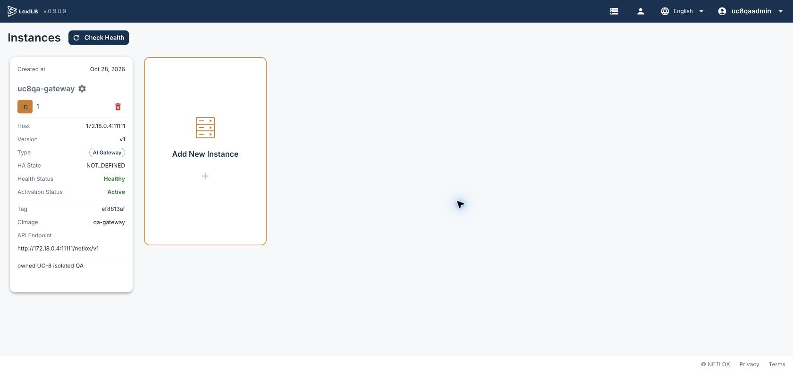

### 설정값을 고르는 순서

| 결정 | 의미 / 선택 방법 |
|---|---|
| Tenant ID | 키 및 정책을 소유하는 팀의 식별자. 같은 팀의 여러 키는 같은 tenant에 속할 수 있습니다. |
| Model Name | 요청 JSON의 `model`과 서비스가 매칭하는 모델 식별자. 대소문자와 경로를 정확히 맞춥니다. |
| Allowed Models | 각 키가 사용할 모델의 쉼표 구분 목록. 빈 값은 모든 모델이므로 제한이 필요하면 명시합니다. |
| Tenant aggregate RPS / TPM | 팀 전체에 대한 초당 요청 / 분당 토큰 예산. 팀의 사용량과 backend 용량에 맞춰 정합니다. |
| Per-model token quota | 한 tenant에서 특정 모델에 허용하는 TPM. 별도 행이 없으면 모델 전용 제한 없이 tenant 전체 제한이 적용됩니다. |
| Key RPS / Burst / TPM | 한 키의 초당 요청, 버킷 총 크기, 분당 토큰 상한. tenant 예산과 별개로 작동할 수 있습니다. |
| Objective / priority class | objective는 우선순위 이름과 값, class는 허용 상한과 관련된 정책입니다. class만으로 모든 요청의 band를 단정하지 않습니다. |
| Admission | 처리 중인 요청 수와 기다릴 수 있는 요청 수·시간을 제한합니다. GPU 자원 할당량을 뜻하지 않습니다. |

## 2. 공통 요청·판정 방법

이 장의 수동 명령은 참조용입니다. 키는 4장에서 발급하므로 지금 실행하지 않고, 우선 3장으로 진행하세요. 패키지의 `verify-*.sh` 명령은 별도 client 컨테이너에서 요청을 실행합니다.

아래 명령은 **실습 client가 있는 셸**에서 실행합니다. `VIP`, `PORT`, `BACKEND`는 같은 client에서 연결 가능한 값으로 설정합니다. Receipt URL은 UC-8 합성 fixture에서만 제공됩니다. fixture는 요청 헤더를 메모리에 보관하므로 receipt의 count만 출력하고 원시 결과나 키를 캡처하지 않습니다. 명령에는 curl과 jq가 필요합니다. 일반 모델 엔진이 receipt API를 제공한다고 가정하지 마세요. HTTPS가 필요한 환경은 관리자가 제공한 CA와 HTTPS URL을 사용합니다.

```bash
export VIP='<전용-Gateway-VIP>'
export PORT='<전용-서비스-포트>'
export BACKEND='<client에서-접근되는-합성-backend-IP>:8080'
export MODEL='shared-model'
```

발급받은 Support 키를 **화면 표시가 없는 입력**으로 받아 curl 설정 파일에 저장합니다. 다른 사용자와 공유하지 않는 디렉터리에서 실행하세요. 키 값에 따옴표나 역슬래시가 포함될 수 있는 환경이라면 조직의 승인된 credential helper를 사용합니다.

```bash
umask 077
mkdir -p "$HOME/uc8-private"
chmod 700 "$HOME/uc8-private"
read -r -s -p 'Support API key: ' UC8_KEY
printf '\n'
printf 'header = "X-Api-Key: %s"\n' "$UC8_KEY" > "$HOME/uc8-private/support.curl"
unset UC8_KEY
chmod 600 "$HOME/uc8-private/support.curl"
```

정상 요청은 사용자가 고유한 nonce를 지정한 후 실행합니다. `--config`에는 비밀 파일 경로만 들어갑니다. 명령은 synthetic fixture에 대한 예이며 body에 민감한 내용을 넣지 않습니다.

```bash
export NONCE='uc8-support-001'
curl --config "$HOME/uc8-private/support.curl" -sS --max-time 15 \
  -H 'Content-Type: application/json' -H "X-Test-Nonce: $NONCE" \
  --data-binary "{\"model\":\"$MODEL\",\"messages\":[{\"role\":\"user\",\"content\":\"hello\"}]}" \
  -w '\nHTTP=%{http_code}\n' "http://$VIP:$PORT/v1/chat/completions"
```

같은 nonce의 백엔드 수신 수를 별도로 확인합니다. fixture의 `/receipt/<nonce>`가 제공하는 `count`를 읽습니다. 요청마다 nonce를 바꾸어 이전 수신과 구분합니다.

```bash
curl -sS --max-time 5 "http://$BACKEND/receipt/$NONCE" | jq '{count}'
```

| 관찰 | 판정 |
|---|---|
| 저장 성공 + Refresh의 동일 설정 | 관리 경로에서 저장과 재조회 확인. 추론 성공은 별도 확인 |
| HTTP 200 + 해당 nonce count 1 | 한 요청이 backend에 도착한 정상 대조 |
| 기대한 401 / 403 / 429 / 503 + count 0 | 해당 요청이 backend에 전달되지 않은 거부 대조 |
| 응답 실패 / receipt 조회 실패 | 수신 0이 아닙니다. 경로와 증거를 먼저 복구 |
| 복구 후 새 nonce의 200 / count 1 | 복구 후 새 요청이 도착함. 이전 요청 처리 결과와 구분 |

## 3. 모델 서비스 만들기

**Traffic → LB Rule → Add**에서 다음 예시를 입력합니다. 패키지의 Gateway 및 Backend IP는 `bash status.sh` 출력에서 확인합니다. 이 서비스에 사용하는 VIP/port와 endpoint는 관리자가 제공한 전용 값으로 바꿉니다. 모델별 rule을 하나의 VIP/port에 공유할 때는 listener의 호환 조건을 확인합니다.

| 구역 | 필드 | 실습 입력 / 이유 |
|---|---|---|
| Basic Settings | Rule Name | `uc8-shared`: 실습 rule 식별 |
| Basic Settings | Protocol / External IP / Port Min | TCP / `status.sh`의 Gateway IP / `20119` |
| Advanced Settings | Mode | `fullproxy`: HTTP 요청의 모델·인증 정책 적용 |
| Advanced Settings | Security / Host | Plain / `status.sh`의 Gateway IP |
| Advanced Settings | Path Match Mode / Path Prefix | `prefix` / `/` 예시. 실제 API 경로에 맞춤 |
| AI Gateway | Data-plane Credential Policy | 첫 smoke는 `Unmanaged`; 키 발급 후 `Required (enforce and strip)`로 변경 |
| AI Gateway | Model Name | `shared-model`: 해당 endpoint pool의 정확한 모델명 |
| AI Gateway | SSE Mode | 실제 streaming이 필요한 서비스에만 선택 |
| Endpoints | IP / Target Port / Weight | 해당 모델 backend 주소 / 8080 / 1 예시 |

1. 기본 주소와 포트를 입력하고 **Advanced Settings**를 펼쳐 mode와 경로를 입력합니다.
2. **AI Gateway**에서 모델을 입력하고 초기 smoke는 credential policy를 Unmanaged로 둡니다. 키 발급 후 Required로 변경합니다. **Admission Control**은 6장에서 설정합니다.
3. **Endpoints → Add**를 눌러 backend 주소, 포트와 weight를 입력하고 **Create**합니다.
4. 성공 메시지를 닫고 **Refresh** 후 정확한 rule을 선택합니다. 상세 Settings와 AI Gateway에서 모델, credential policy, endpoint와 admission 값을 대조합니다. 설정 성공과 데이터 경로 전달은 구분합니다.
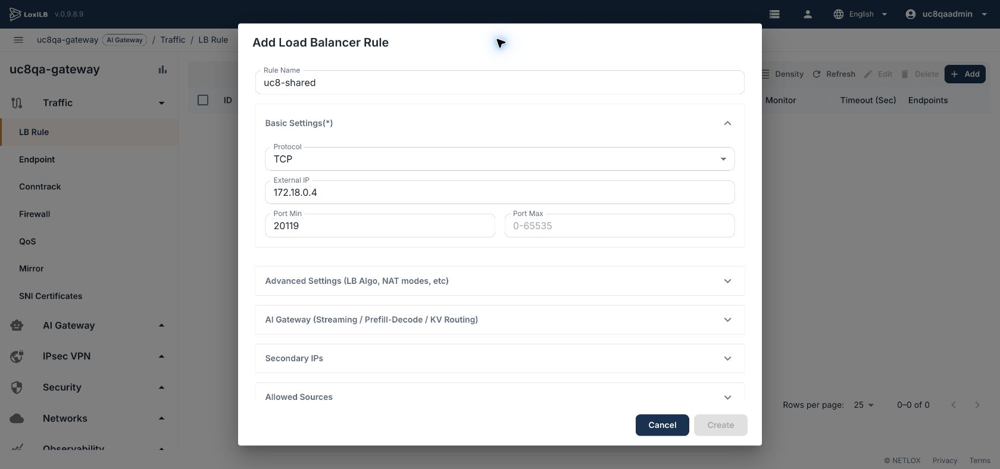

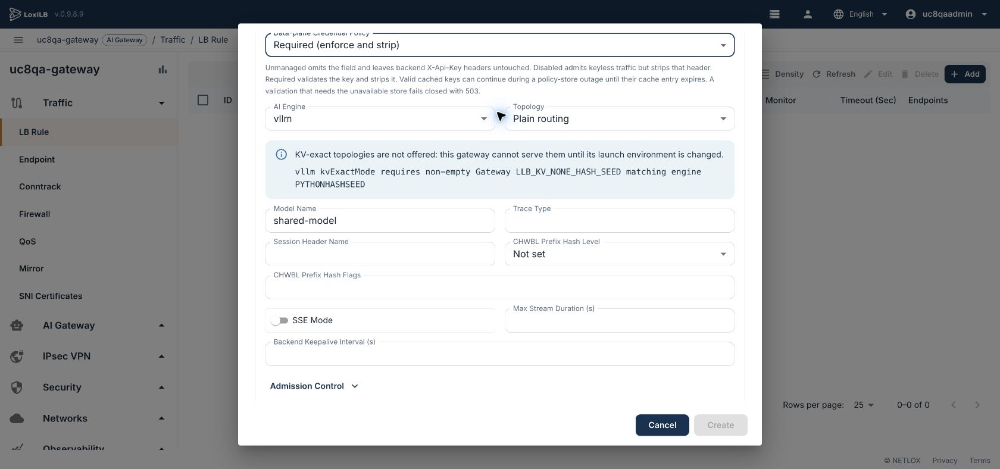

5. 두 번째 rule `uc8-other`를 같은 방법으로 추가합니다. External IP와 Host는 `status.sh`의 Gateway IP, 포트는 `20120`, Mode는 `fullproxy`, Path Match Mode는 `prefix`, Path Prefix는 `/`, Data-plane Credential Policy는 `Required`, Model Name은 `other-model`입니다. Endpoint는 **Other backend IP**의 `8080`, weight `1`입니다. 실측 주소는 `172.20.0.8`이지만 설치마다 바뀝니다.

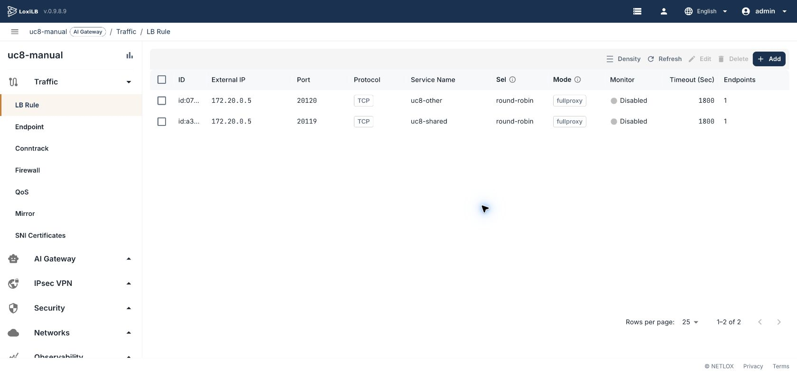

### 3.1 키 없이 기본 연결을 먼저 확인

인증 기능을 설정하기 전에 같은 항목을 **Unmanaged (no policy)**로 두고 저장해 기본 경로를 확인합니다. 이 상태는 오직 격리된 실습에 사용합니다. UI에서 생성한 `uc8-shared`, port `20119`, model `shared-model` rule과 package backend가 있어야 합니다. 아래는 **실습 호스트의 lab 디렉터리**에서 실행합니다.

```bash
bash verify-smoke.sh
```

기대 출력은 `HTTP 200 backend count 1`입니다. 고유 nonce로 요청해 합성 backend의 receipt를 별도로 읽습니다. 2026-10-28 원격 별도 Compose 환경에서 UI로 rule을 생성하고 동일 요청의 200 / 수신 1을 확인했습니다. 이 결과는 키 인증·모델 권한이나 admission을 확인한 것이 아닙니다. 다음 4장에서 키를 발급한 뒤 이 rule의 **Data-plane Credential Policy**를 Required로 변경하고 재조회합니다.

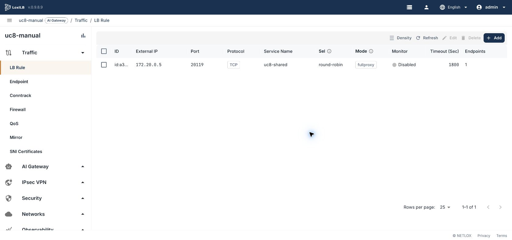

## 4. 모델별 접근: 팀별 API key

3.1 smoke 이후 이 장의 키를 발급하고 rule의 credential policy를 Required로 변경합니다. 변경된 저장값을 재조회한 후 허용·거부 요청을 확인합니다.

### 4.1 키 발급

**AI Gateway → AI API Keys → Add**를 엽니다. 실습 A의 예시는 다음과 같습니다.

| UI 필드 | Support | Research | 의미 |
|---|---|---|---|
| Import existing key | 선택 | 선택 가능 | 이번 실습은 임의의 합성 키를 직접 입력해 발급 |
| Tenant ID | `uc8-support` | `uc8-research` | 각각 팀별 정책을 연결 |
| Name | `uc8-support-key` | `uc8-research-key` | 사람이 관리할 이름 |
| Allowed Models (comma-separated) | `shared-model` | `shared-model,other-model` | 정확한 모델 이름. 빈 값은 모든 모델 |
| Rate Limit (req/s) | `0` | 예: `2` | 키별 요청/초. 0은 키 자체에 제한 없음 |
| Burst Size | `0` | 예: `2` | 총 버킷 크기. 0이면 RPS 값 사용 |
| Tokens / Minute | 예: `0` | 예: `0` | 키별 TPM. 0은 키 자체에 제한 없음 |
| Expires At / Enabled | 실습 종료에 맞춘 만료 / Enabled | 동일 | 유효 기간 및 활성 상태 |

1. 실습 호스트에서 아래 명령으로 시험용 키를 생성합니다. 결과는 사용자만 읽을 수 있는 파일에 보관합니다. 안전한 터미널에서 `cat private/support-key`로 원문을 확인해 UI **Import existing key → Existing API key** 필드에 입력하세요. 키 원문이 표시되는 화면을 촬영하거나 공유하지 마세요.

   ```bash
   umask 077
   openssl rand -hex 32 > private/support-key
   chmod 600 private/support-key
   ```

   Support 키는 이 합성 무작위 값을 사용하여 **Import existing key**로 입력합니다. 원문을 화면 캡처에 남기지 마세요. 키 RPS, Burst, TPM은 우선 `0`으로 설정합니다. 필요하면 아래 **Request Priority** 설정을 7장에 따라 입력합니다.
2. **Add → OK**를 선택합니다. 생성 방식으로 키를 발급할 수도 있지만 원문은 한 번만 표시되므로 즉시 안전하게 보관합니다. 원문이 보이는 화면을 촬영하지 않습니다.
3. 목록을 Refresh하고 해당 행의 tenant, 이름, Allowed Models, Enabled 및 한도를 확인합니다. 키 ID와 원문은 다릅니다.
4. 이 실측은 Support 키 하나만 사용했습니다. Research 키는 추가 실습입니다. 다음 단계에서는 같은 Support 키의 허용 목록을 바꿔 두 listener를 비교합니다.

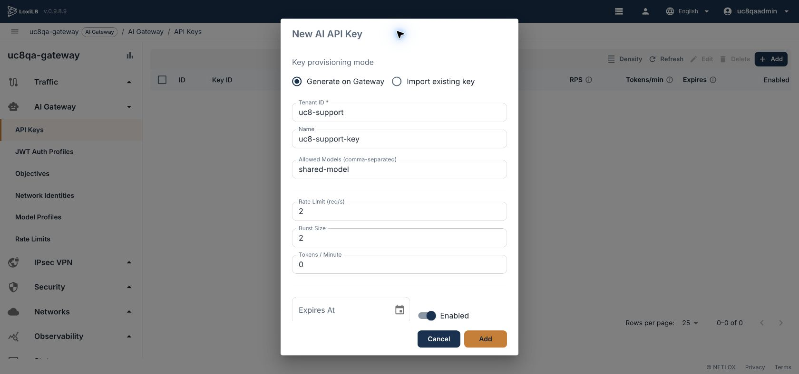

### 4.2 허용·거부 확인

4.1에서 생성한 `private/support-key`를 사용합니다. 다른 방식으로 발급받았다면 실습 호스트의 `lab` 디렉터리에서 아래처럼 표시 없이 입력해 저장합니다. 쉘 히스토리, 캡처나 채팅에 키를 남기지 마세요.

이미 4.1에서 파일을 만들었다면 다음 입력 블록은 건너뛰고, 인증 정책 변경 후 `bash verify-access.sh`만 실행합니다.

```bash
umask 077
read -r -s -p 'Support API key: ' UC8_KEY
printf '\n'
printf '%s' "$UC8_KEY" > private/support-key
unset UC8_KEY
chmod 600 private/support-key
```

UI에서 `uc8-shared` rule의 **Data-plane Credential Policy**를 `Required`로 변경합니다. endpoint pool 재구성 확인창이 뜨면 내용을 확인하고 **Rebuild endpoint pool → OK**를 선택한 뒤 실행합니다.

```bash
bash verify-access.sh
```

실측 결과는 허용 `shared-model` 200/수신 1, 비허용 `other-model` 403/수신 0, 키 누락 401/수신 0입니다. 이 검사는 첫 listener에서 실행한 권한 검사 대조입니다. 두 번째 listener의 실제 경로는 바로 아래에서 별도로 확인합니다.

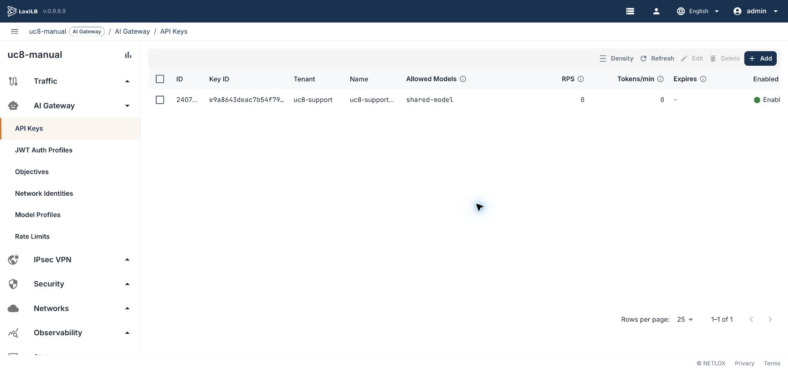

기존 실습 화면: 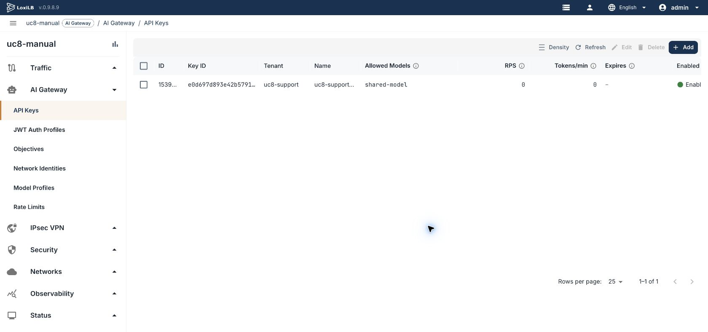

### 4.2.1 두 모델의 실제 경로와 키 권한

3장에서 두 rule을 모두 만들고, Support 키의 Allowed Models가 `shared-model`만 포함하는지 확인합니다. 첫 명령은 각 요청의 nonce에 대해 **두 backend의 receipt를 모두** 조회합니다.

```bash
bash verify-two-models.sh denied
```

실측 결과는 `shared-model HTTP 200 backend counts 1 0`, `other-model HTTP 403 backend counts 0 0`입니다. API Keys에서 Support 키를 Edit하고 Allowed Models를 `shared-model,other-model`로 변경한 뒤 Apply → OK → Refresh합니다. 키의 다른 제한 필드는 변경하지 않습니다.


```bash
bash verify-two-models.sh allowed
```

실측 결과는 각각 `200 backend counts 1 0`과 `200 backend counts 0 1`입니다. 이후 Support 키의 Allowed Models를 `shared-model`로 되돌립니다. 모델별 별도 포트와 합성 endpoint를 사용한 검증이며, 하나의 listener에서 모델명을 기준으로 자동 분기하거나 실제 GPU 모델을 실행한 시험은 아닙니다.

### 4.3 키 RPS 초과와 회복

API Keys에서 Support 행을 선택해 Edit하고 **Rate Limit** `1`, **Burst Size** `1`을 적용합니다. 이 단계에서는 tenant 설정 전입니다. 이 전용 신규 실습에서 tenant와 전역 default에 별도의 제한이 없는지 확인합니다. 5장에서 tenant 예산을 설정합니다. 적용 직후 2초 이상 기다린 뒤 실행합니다.

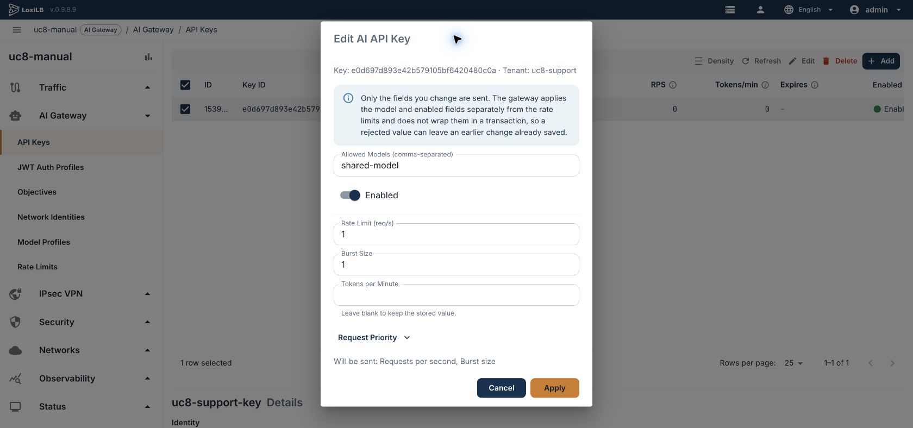

```bash
bash verify-key-rps.sh
```

실측: 첫 요청 200/수신 1, 즉시 다음 요청 429/수신 0, 2초 후 200/수신 1. 이후 대기열 시험 전에 동일 키의 RPS와 Burst를 `0`으로 되돌립니다. 0은 해당 키 자체의 제한을 제거하며 다른 tenant/default 제한은 계속 적용될 수 있습니다.

## 5. 테넌트 전체 및 모델별 예산

**AI Gateway → Rate Limits**의 **AI Tenant Rate Limits → Add**를 선택합니다. 테스트 전 global 및 rule defaults를 확인합니다. tenant 행의 RPS/TPM 0은 해당 행의 제한이 없다는 뜻이며, 설정된 tenant default가 있으면 그 default가 적용됩니다. default도 없는 경우에만 무제한입니다.

| 필드 | 예시 | 설명 |
|---|---:|---|
| Tenant ID | `uc8-support` | 키의 Tenant ID와 정확히 일치 |
| Rate Limit (req/s) | `4` | 팀 전체 RPS 예시. 실제 요청률과 default를 고려 |
| Tokens / Minute | `1000` | 팀 전체 TPM 예시. 실제 usage 및 토큰 크기를 고려 |
| Burst Percentage | `100` | TPM 기준 burst의 백분율. 0은 Gateway/process 기본값, 1–1000 지정 |
| Model | `shared-model` | 요청에 쓰는 정확한 모델명 |
| Model Tokens / Minute | `600` | 이 tenant의 해당 모델에 적용되는 추가 TPM 예시 |

1. 전체 세 필드를 입력합니다. 이 폼의 Apply는 RPS, TPM, burst를 함께 교체하므로 하나만 수정해도 나머지 현재 값을 확인합니다.
2. **Add model quota**를 눌러 모델명과 TPM을 입력합니다. 같은 모델은 한 번만 입력합니다. 추가 모델은 버튼을 다시 누릅니다.
3. **Apply → OK → Refresh** 후 정확한 tenant의 aggregate 값과 모델별 값을 재조회합니다. 삭제 아이콘은 해당 모델 quota를 제거합니다. 모델 TPM `0`도 모델별 quota 제거이며 해당 모델의 요청을 금지하는 뜻이 아닙니다.
4. 별도 팀이 필요하면 해당 tenant를 추가합니다. 다음 모델 TPM 시험은 Support만 사용했습니다.

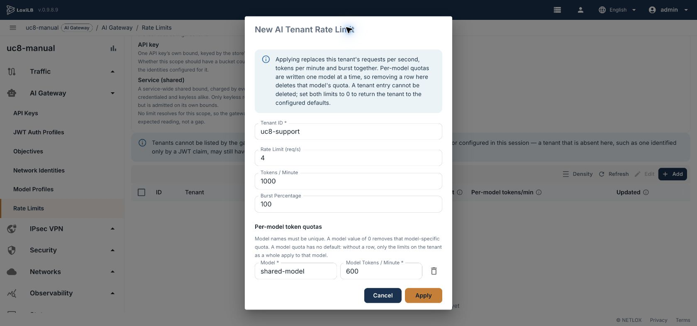

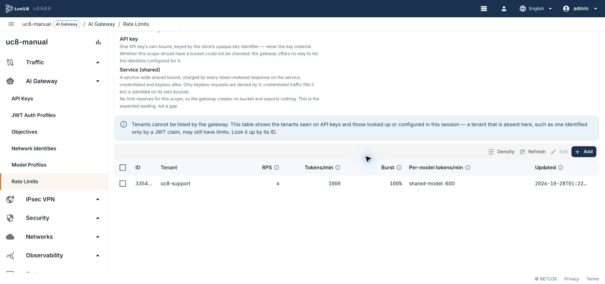

별도 Gateway readback을 실습 호스트의 lab 디렉터리에서 확인합니다.

```bash
bash verify-tenant.sh uc8-support
```

예시에서는 `rps=4`, `tokens_per_min=1000`, `burst_pct=100`, `shared-model`의 TPM `600`을 기대합니다. priority를 7장까지 설정한 뒤에는 `critical`과 `uc8-interactive`도 대조합니다. 최신 Gateway 리허설에서 UI 저장 후 동일 readback을 확인했습니다. 아래 100 TPM 시험에서 초과 차단도 확인했으며, 600 TPM 설정 자체의 초과 시험은 수행하지 않았습니다.

### 5.1 모델 TPM 초과 실습

Support tenant Edit에서 aggregate RPS와 TPM을 각각 `0`, Burst `100`, `shared-model` TPM을 `100`으로 변경합니다. Support key RPS/Burst는 `0`이어야 합니다. 다른 default 제한이 없음을 확인한 후 다음을 실행합니다.

```bash
bash verify-model-tpm.sh
```

합성 backend는 응답당 usage 4 tokens를 반환합니다. 실측에서는 20건이 200/수신 1이었고 21번째가 `token_quota_would_exceed`, 429/수신 0이었습니다. 예약 추정과 기존 버킷 잔량, refill에 따라 초과되는 요청 번호는 달라집니다. 첫 요청부터 429이면 잔량이 회복될 때까지 기다리고 다른 한도도 확인하세요. 시험 후 tenant aggregate `4` RPS / `1000` TPM 및 모델 `600` TPM으로 복원합니다.

기존 tenant를 덮어쓸 때는 설정된 전체 값과 모델 행을 먼저 기록합니다. UI가 행을 삭제하면 해당 모델 quota가 제거됩니다. tenant 삭제 API가 없는 검증 버전에서는 삭제 대신 본인이 만든 항목을 중립화하더라도 행이 남습니다.

## 6. 처리 용량과 대기열

3장의 전용 rule을 선택하고 **Edit → AI Gateway → Admission Control**을 펼칩니다. 다음은 부하를 의도적으로 작게 만든 **독립 합성 시험값**입니다.

| 필드 | 값 | 이유 |
|---|---:|---|
| Admission Mode | `enforce` | 관찰만 하는 것이 아니라 제한 적용 |
| Max Outstanding | `1` | 동시에 실행 중인 요청 한 개 |
| Queue Depth | `1` | 슬롯이 찼을 때 한 요청 대기 |
| Queue Wait (ms) | `5000` | 대기 제한 시간 5초 |

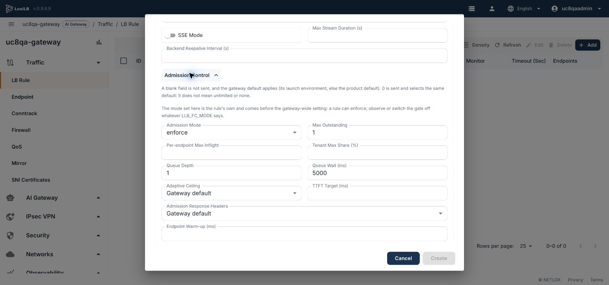

**Update** 후 endpoint pool 재구성 확인창이 표시되면 변경 영향과 필드를 확인한 뒤 **Rebuild endpoint pool → OK → Refresh**를 누르고 상세 값을 확인합니다. 합성 backend는 `X-Test-Hold: 1` 요청을 유지하고 `/release/<nonce>`로 해제할 수 있어야 합니다. 첫 요청을 hold하고 그 receipt가 1인지 확인한 뒤, 두 번째 요청을 보내 Gateway에서 대기 중임을 확인합니다. 즉시 세 번째 요청을 보냅니다. 429/수신 0을 확인한 후 첫 요청을 해제하고 두 번째의 200/수신 1을 확인합니다. 모든 대기 요청을 finally 경로에서 해제합니다. 지정된 5초가 지나면 의도한 overflow 대신 queue timeout이 발생할 수 있습니다.

실습 패키지에서는 타이밍과 정리까지 처리하는 검증 스크립트를 우선 사용합니다. Support key의 RPS/Burst를 `0`으로 복원하고 tenant와 모델에 충분한 여유가 있는지 확인하세요.

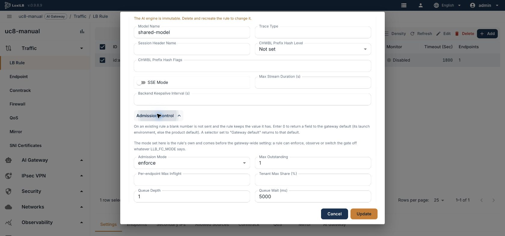

```bash
bash verify-queue.sh
```

실측에서 첫 요청이 수신되고 두 번째 요청의 `queued=1`을 확인한 후 세 번째는 429/수신 0이었으며, 첫 요청을 해제한 뒤 두 번째는 200/수신 1이었습니다. 다음 명령은 같은 흐름의 수동 설명입니다.

다음은 **client 셸에서 순서대로** 실행하는 합성 fixture 예시입니다. `hold`, `queued`, `overflow`에는 실행마다 다른 nonce를 사용합니다. 실습 키는 4장에서 발급하고 2장의 `support.curl`에 저장해야 합니다. 이 대조에서는 키·tenant의 RPS/TPM 및 default가 병목이 되지 않도록 전용 실습 정책을 준비하고 저장값을 확인합니다. 요청이 5초 이내에 대기열에 들어가지 않거나 상태를 확인할 수 없으면 중단하고 holder를 해제합니다.

```bash
export H='uc8-hold-001' Q='uc8-queue-001' X='uc8-overflow-001'
export BODY="{\"model\":\"$MODEL\",\"messages\":[{\"role\":\"user\",\"content\":\"hello\"}]}"
curl --config "$HOME/uc8-private/support.curl" -sS --max-time 15 \
  -H 'Content-Type: application/json' -H "X-Test-Nonce: $H" -H 'X-Test-Hold: 1' \
  --data-binary "$BODY" -w '\nHTTP=%{http_code}\n' \
  "http://$VIP:$PORT/v1/chat/completions" > "$HOME/uc8-private/held-result" &
export HOLD_PID=$!
```

```bash
curl -sS --max-time 5 "http://$BACKEND/receipt/$H" | jq '{count}'
```

`count=1`을 확인한 다음 두 번째 요청을 백그라운드로 시작합니다. UI의 상세 **Priority band state** 또는 Gateway effective 조회에서 대기를 확인하고 즉시 세 번째 요청을 보냅니다.

```bash
curl --config "$HOME/uc8-private/support.curl" -sS --max-time 15 \
  -H 'Content-Type: application/json' -H "X-Test-Nonce: $Q" \
  --data-binary "$BODY" -w '\nHTTP=%{http_code}\n' \
  "http://$VIP:$PORT/v1/chat/completions" > "$HOME/uc8-private/queued-result" &
export QUEUE_PID=$!
```

```bash
curl --config "$HOME/uc8-private/support.curl" -sS --max-time 5 \
  -H 'Content-Type: application/json' -H "X-Test-Nonce: $X" \
  --data-binary "$BODY" -w '\nHTTP=%{http_code}\n' \
  "http://$VIP:$PORT/v1/chat/completions"
curl -sS --max-time 5 "http://$BACKEND/receipt/$X" | jq '{count}'
```

429와 count 0을 확인합니다. 첫 요청을 해제하고 두 프로세스의 종료와 각 결과를 확인합니다. 오류나 중단 시에도 release를 실행합니다. 출력 파일에는 응답 본문이 있으므로 합성 데이터만 사용하고 개인 요청을 저장하지 않습니다.

```bash
curl -sS --max-time 5 "http://$BACKEND/release/$H"
wait "$HOLD_PID"
wait "$QUEUE_PID"
cat "$HOME/uc8-private/held-result" "$HOME/uc8-private/queued-result"
curl -sS --max-time 5 "http://$BACKEND/receipt/$Q" | jq '{count}'
```

2026-10-28 전용 QA에서는 위 1/1/5000 설정에서 첫 요청 hold, 두 번째 대기, 세 번째 429/수신 0, 해제 후 두 번째 200/수신 1을 확인했습니다. 별도 시험의 `504 admission_queue_timeout`과 `429 admission_ttl_expired`는 서로 다른 만료 조건입니다. 클라이언트 timeout과 Gateway 응답을 구분합니다.

## 7. 업무 우선순위와 공유 순서

### 7.1 Objective 및 팀 정책

1. **AI Gateway → Objectives → Add**에서 **Name** `uc8-interactive`, **Priority** `10`을 입력하고 **Add → OK**를 누릅니다. Refresh 후 이름과 `critical` 표시를 확인합니다. 실측에서 `-5`는 `sheddable`로 표시됐습니다.
2. **AI Gateway → Rate Limits**의 Support tenant를 선택해 **Edit**하고 **Request Priority**를 펼칩니다. **Priority Class** `critical`, **Default Objective** `uc8-interactive`, **Allowed Objectives (comma-separated)** `uc8-interactive`를 지정합니다. 전체 RPS/TPM/burst와 모델 행을 보존한 후 **Apply**합니다.
3. Support 키의 **Request Priority**에도 동일한 class, default 및 allowed objective를 지정하고 저장·재조회합니다. Research는 사용 목적에 맞는 정책을 별도로 정합니다.
4. 미등록 objective 경고나 저장 실패가 보이면 목록을 다시 읽고 이름과 tenant/key 허용 범위를 확인합니다. Priority class cap만 지정해 실제 band가 critical이라고 단정하지 않습니다.

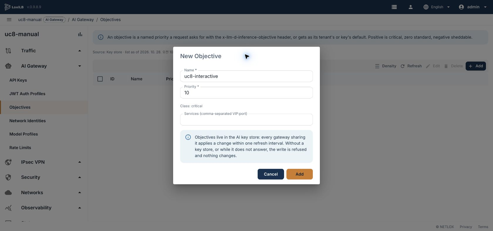

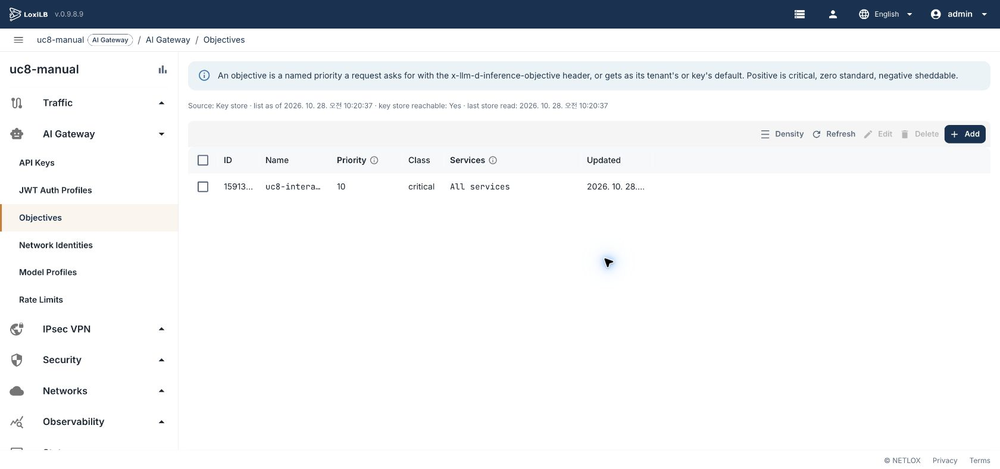

UI 저장을 확인한 뒤 Linux 실습 호스트의 `lab` 디렉터리에서 Gateway를 독립 조회합니다.

```bash
bash verify-objective.sh uc8-interactive
```

기대 출력은 `{"name": "uc8-interactive", "priority": 10}`입니다. 2026-10-28 별도 실습 패키지에서 UI 저장과 이 readback을 확인했습니다.

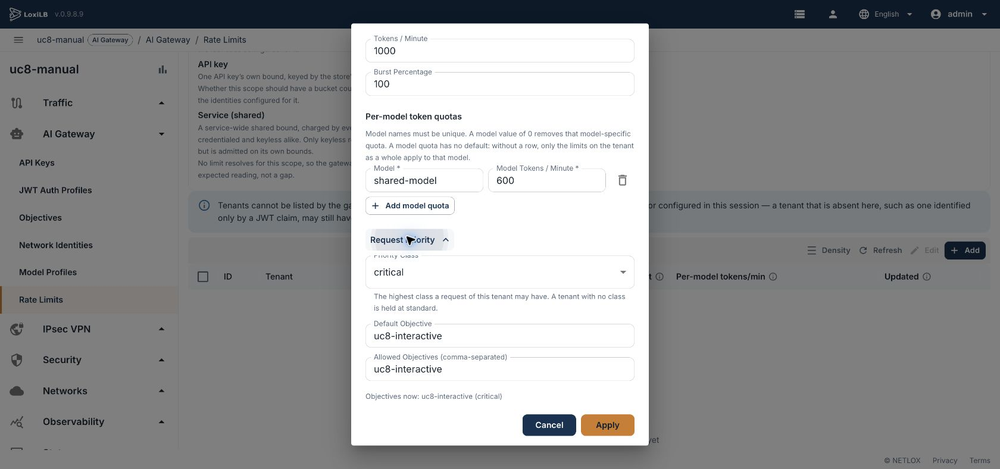

### 7.2 선택 실습: 실제 대기 및 처리 순서

이 절은 본 all-in-one 기본 리허설 범위가 아닌 별도 CLI 시험에 대한 참고입니다. 동일 실습 명령과 Research 키 준비가 포함되어 있지 않습니다. strict 시험은 6장의 queue depth 1이 아니라 **두 개 이상의 대기를 수용하는 별도 전용 rule**이 필요합니다. QA에서는 CLI로 `strict`, outstanding 1, queue 4, wait 30000ms, shed queue on을 설정했습니다. **Traffic → LB Rule**에서 해당 rule 선택 → **AI Gateway** 상세 → **Priority band state**를 확인합니다.

1. Support 요청 하나를 backend에서 hold해 슬롯을 점유합니다.
2. Research의 sheddable 요청을 먼저 보내고 Gateway와 UI에서 해당 band의 Waiting 1을 확인합니다.
3. Support의 critical 요청을 보내고 critical과 sheddable이 각각 Waiting 1인지 확인합니다.
4. holder를 해제하고 critical의 backend 수신을 확인합니다. critical을 해제한 뒤 sheddable 수신과 세 요청의 최종 200을 확인합니다. 각 요청은 독립 nonce를 씁니다.

전용 QA에서는 holder → critical → sheddable 순서, 각 200 및 키 없는 요청 401/수신 0을 확인했습니다. 이는 실행 중 요청을 선점한다는 의미가 아닙니다. UI의 Waiting 값과 Gateway 수치를 해당 실행에서 비교했습니다.

### 7.3 참고: Weighted와 tenant RR

이 UI는 검증한 버전에서 band 가중치와 in-band tenant RR의 전문가 입력을 직접 제공하지 않습니다. CLI로 별도 전용 rule에 설정한 후 UI 상세의 **Wake Policy**와 **In-band Order**, Gateway readback 및 backend 순서를 대조합니다. 실측은 weighted `8:3:1` 대기열에서 첫 12 dispatch가 8:3:1이었던 유한 시험과, 같은 band에서 A1/A2/B1 대기 후 A1/B1/A2가 처리된 한 RR 시험입니다. 장기 공정성, latency 또는 GPU 자원 배분 보장은 아닙니다. UI 편집 전후 CLI 전용 필드 readback을 비교하세요.

## 8. 참고: 네트워크 식별과 tenant 접근

이 절은 별도 CLI와 네트워크 준비가 필요한 참고 항목입니다. 검증한 버전의 **AI Gateway → Network Identity**는 읽기 전용입니다. binding의 생성·변경은 CLI가 필요합니다. 전용 client의 실제 source IP, 해당 서비스와 소유 tenant를 먼저 확인하고 기존 binding과 충돌하지 않는 고유 이름을 사용합니다. CLI의 `--cidr`, `--services`, `--enforce`, `--forward-identity` 사용법은 LoxiLB의 공개 네트워크 식별 문서을 참조합니다.

전용 QA의 한 CIDR 시험에서 strict binding과 일치하는 tenant key는 200/수신 1, 불일치 key는 403/수신 0이었습니다. advisory 변경 후 불일치 key는 자신의 tenant로 200/수신 1이었습니다. UI 목록에서 이름, tenant, CIDR과 enforce를 확인하고 각 시험은 새 nonce로 비교합니다. strict는 일치 강제, advisory는 관찰/귀속을 선택할 때 사용하는 구분입니다. VLAN 310과 VXLAN VNI 322의 별도 소프트웨어 시험은 실제 물리 네트워크 검증이 아닙니다.

## 9. 저장소 장애와 복구

실습 호스트에서만 아래를 실행합니다. `on`은 해당 Compose Gateway 컨테이너에서 이 프로젝트 DB 주소에 대한 경로만 차단하며 120초 후 자동 복구를 시도합니다. `off`는 소유 marker와 경로를 확인해 제거합니다. 다른 프로젝트나 운영 환경에서 실행하지 마세요.

```bash
bash store-fault.sh on
# UI Objectives에서 Refresh 후 기존 objective 및 경고를 확인하고,
# 새 이름 uc8-outage-denied로 Add를 시도합니다.
bash store-fault.sh off
bash verify-objective.sh uc8-interactive
bash verify-access.sh
```

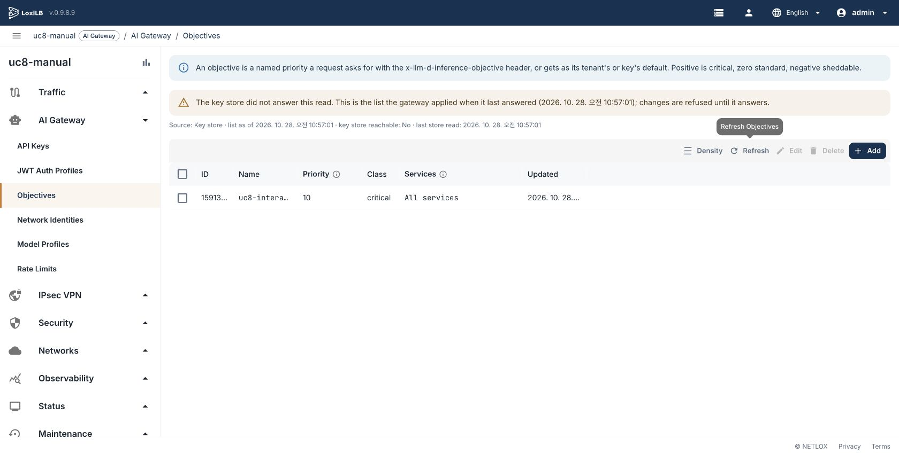

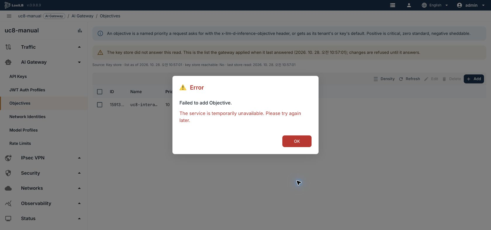

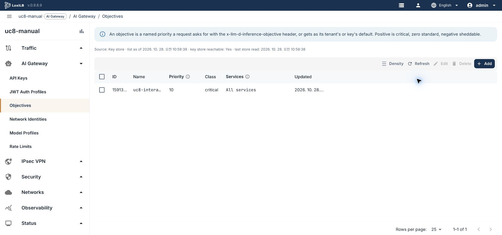

실측에서 기존 objective는 표시되고 새 objective 저장은 UI에서 일시적 오류로 거부됐습니다. 복구 후 명시적 Refresh에서 저장소 연결이 정상이며 거부된 이름이 저장되지 않았음을 조회했습니다. 재시험에서 복구 후 접근 대조는 200/1, 403/0, 401/0이었습니다. 초기 복구 스크립트는 경로 출력의 공백 처리 때문에 한 차례 실패했고 이후 수정하여 `on`/`off`를 재검증했습니다.

Objectives 목록에서 저장소 경고가 보이면 새로 성공한 Gateway 조회의 `source`, `store_reachable`을 확인합니다. 이전에 적용된 값이 LKG로 표시되어도 새 쓰기가 저장된 것은 아닙니다. 전용 시험에서 저장소 연결 중단 시 기존 objective는 표시되고 새 objective 쓰기는 503으로 거부됐습니다.

별도의 cold Gateway 시험에서 **장애 전 정상 동작한 기존 유효 키**는 저장소 단절 중 503/수신 0이었고, 저장소 경로를 복구한 뒤 같은 키로 200/수신 1을 확인했습니다. 별도 network credential의 키 없는 요청은 장애 중 200으로 처리된 사례가 있으므로 인증 방식별로 판정합니다. 복구 후 **Refresh**를 눌러 새 조회의 `source=store`, `store_reachable=true`와 경고 해제를 확인합니다. 브라우저 reload만으로 즉시 재조회되지 않은 관찰이 있어 명시적 Refresh 결과와 구분합니다.

### 9.1 Gateway 재시작 확인

Gateway `554c7932`는 PR #486 수정으로 sockmap에 필요한 cgroup2 마운트를 자체 확인합니다. 실습 Compose에서 별도 사전 마운트 우회를 사용하지 않습니다. 전용 원격 테스트베드에서 동일 컨테이너를 두 번 재시작하고 cgroup2 마운트와 요청 복구를 확인했습니다. [검증 기록](VALIDATION.ko.html)을 참조하세요.

실습 rule 및 objective가 준비되고 저장된 후에만 전용 프로젝트에서 실행합니다. 진행 중인 요청은 끊길 수 있습니다.

```bash
bash verify-objective.sh uc8-interactive
bash verify-access.sh
docker compose restart gateway
bash status.sh
bash verify-objective.sh uc8-interactive
bash verify-access.sh
```

별도 `uc8-manual-v4`와 공개 소스 빌드 이미지의 `uc8-manual-v5` 프로젝트에서 보완된 동일 컨테이너를 재시작하기 전후 readiness 및 관리 API 200, 저장한 objective(priority 10), API key Required인 두 rule의 각 모델 요청 200/수신 1을 확인했습니다. 시험 키와 rule은 이 별도 프로젝트에 생성했습니다. Gateway 주소가 바뀌면 UI 인스턴스와 rule의 주소를 다시 확인하세요. 실패하면 `docker compose ps -a`와 `docker compose logs --tail=100 gateway`를 살펴보고 비밀이 포함된 로그는 공유하지 않습니다.

## 10. 정리와 원복

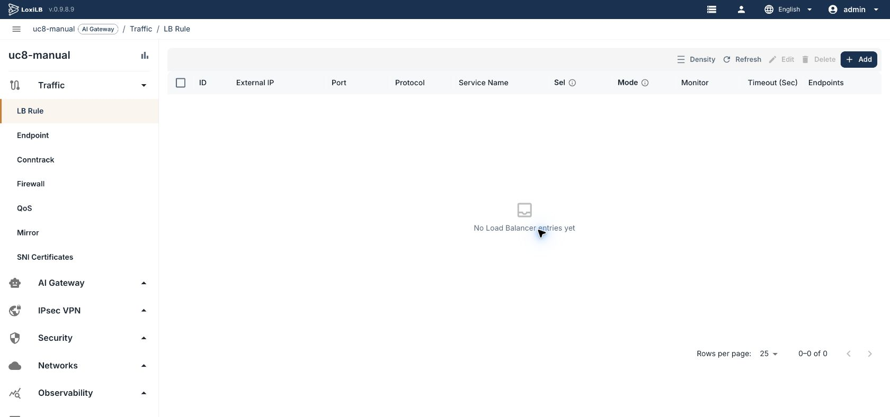

1. 진행 중인 hold 요청이 없다면 **API Keys**에서 본인이 만든 `uc8-support-key`만 삭제하고 Refresh에서 부재를 확인합니다. 이 실습에서 UI 삭제 후 같은 키는 401/수신 0이었습니다. rule이 남아 있을 때 다음을 실행합니다. `private/support-key`는 원문을 출력하지 않고 표준 입력으로 전달됩니다.

```bash
docker compose exec -T client python -c '
import json,sys,urllib.request,urllib.error,uuid
key=sys.stdin.read().strip(); assert key
nonce="uc8-deleted-"+uuid.uuid4().hex
body=json.dumps({"model":"shared-model","messages":[{"role":"user","content":"hello"}]}).encode()
request=urllib.request.Request("http://gateway:20119/v1/chat/completions",data=body,headers={"Content-Type":"application/json","X-Api-Key":key,"X-Test-Nonce":nonce})
try:
 with urllib.request.urlopen(request,timeout=10) as response: status=response.status
except urllib.error.HTTPError as error: status=error.code
with urllib.request.urlopen("http://backend:8080/receipt/"+nonce,timeout=5) as response: count=json.load(response)["count"]
print("deleted key HTTP",status,"backend count",count)
if (status,count)!=(401,0): raise SystemExit("Expected 401 / 0; inspect policy and cache state")
' < private/support-key
```

2. **Rate Limits → Tenant ID lookup**에서 `uc8-support`를 직접 찾아 선택하고 Edit합니다. 키 삭제 후 목록에 tenant가 안 보여도 정책은 남을 수 있습니다. 이 전용 실습에서는 RPS, TPM, burst를 `0`, `shared-model` TPM을 `0`으로 설정하고, Request Priority의 class를 **Unset**, Default Objective와 Allowed Objectives를 빈 값으로 변경해 Apply합니다. 기존 공유 tenant라면 실습 전 기록한 값으로 복원합니다. 0은 설정된 default가 있으면 그 default를 따른다는 점을 확인합니다.
3. 실습 objective `uc8-interactive`와 본인이 만든 network identity가 있으면 정확한 이름을 확인하여 삭제하고 성공한 재조회에서 부재를 확인합니다. tenant/key가 참조하는 objective 이름은 삭제 전에 지우는 것이 안전합니다.
4. **LB Rule**에서 본인이 만든 `uc8-shared`, `uc8-other`만 선택해 삭제합니다. Refresh 후 두 행의 부재를 확인합니다. 각 삭제는 되돌릴 수 없습니다.
5. 실습 호스트에서 `bash verify-tenant.sh uc8-support`로 확인합니다. 이 버전에서는 중립화된 필드가 `null`로 표시될 수 있으며 tenant 삭제 API가 없어 행은 남을 수 있습니다. 성공적으로 조회하지 못했다면 정리 완료라고 기록하지 않습니다.
6. [패키지의 완전 폐기 절차](lab/README.ko.html)를 따라 전용 프로젝트만 중지하고 볼륨·네트워크 회수 여부를 확인한 후, `private/`의 비밀 파일을 폐기합니다. `stop.sh`만 실행하면 볼륨과 비밀 파일은 남습니다.

## 11. 실측과 미검증 범위

2026-10-28 전용 QA tuple은 UI `12d5834d`, Gateway `031f2aa`, OAM `f28dda04`, CLI `ad1e7776`입니다. 실제 Chromium/OAM/Gateway 및 합성 backend로 objective CRUD, tenant/key priority 저장과 조회, admission 요청·대기·429, controlled strict/weighted/tenant RR, CIDR identity, store outage/cold LKG와 복구를 각각 확인했습니다. 이 내용은 이전 버전의 별도 QA이며 본 배포본의 기본 실습에 포함되지 않습니다.

두 모델은 별도 listener와 합성 backend로 검증했습니다. 실제 모델 엔진, 물리 네트워크, 실제 GPU 성능, 장기 공정성과 상용 SIEM은 미검증입니다. QA는 전용 합성 환경에 한정되며 제품 전체·운영 배포·인증 합격을 뜻하지 않습니다.
